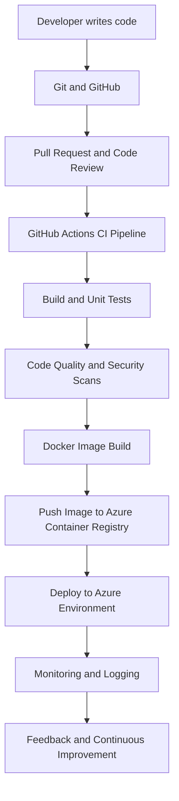

# DevOps Roadmap 🚀

A structured, step-by-step learning journey to understand DevOps concepts, tools, automation, cloud infrastructure, and real-world implementation.

This repository is designed to help beginners and working professionals learn DevOps from fundamentals to advanced concepts through simple explanations, practical examples, hands-on labs, and real-time projects.

---

## 🎯 Objectives

The main objectives of this repository are:

- Understand DevOps fundamentals and principles.
- Learn the tools and technologies used in real-world DevOps environments.
- Gain practical experience through hands-on exercises.
- Understand how applications move from development to production.
- Learn CI/CD pipeline implementation and automation.
- Explore cloud infrastructure, Infrastructure as Code (IaC), and configuration management.
- Build end-to-end DevOps projects.
- Prepare for real-world DevOps responsibilities and technical interviews.

---

## 🗺️ Complete DevOps Learning Roadmap

Follow the learning path step by step.

| Phase | Technology / Topic | Learning Focus |
|---|---|---|
| 01 | DevOps Fundamentals | Concepts, principles, lifecycle, culture |
| 02 | Networking Fundamentals | IP, DNS, ports, HTTP/HTTPS, firewalls |
| 03 | Cloud Computing | Cloud concepts and service models |
| 04 | Microsoft Azure | Core services, compute, networking, storage |
| 05 | Git & GitHub | Version control, branching, merging, pull requests |
| 06 | Linux | Commands, processes, services, permissions |
| 07 | Shell Scripting | Bash scripting and automation |
| 08 | Build Tools | Maven, .NET build and packaging |
| 09 | Docker | Images, containers, volumes, networking |
| 10 | GitHub Actions | CI/CD pipelines and workflow automation |
| 11 | Infrastructure as Code | Terraform, ARM Templates, Bicep |
| 12 | Ansible | Configuration management and automation |
| 13 | Kubernetes | Container orchestration and deployments |
| 14 | Monitoring | Logs, metrics, alerts, observability |
| 15 | DevSecOps | Security scanning and pipeline security |
| 16 | Real-Time Projects | End-to-end DevOps implementation |

---

## 📚 Learning Repositories

Each technology will have a dedicated repository containing detailed notes, examples, practical exercises, and projects.

| Repository | Description |
|---|---|
| [devops-roadmap](https://github.com/YOUR-USERNAME/devops-roadmap) | Main roadmap and learning guide |
| [devops-foundations](https://github.com/YOUR-USERNAME/devops-foundations) | DevOps concepts and fundamentals |
| [azure-learning](https://github.com/YOUR-USERNAME/azure-learning) | Microsoft Azure services and implementation |
| [git-github-learning](https://github.com/YOUR-USERNAME/git-github-learning) | Git and GitHub |
| [linux-learning](https://github.com/YOUR-USERNAME/linux-learning) | Linux administration |
| [shell-scripting](https://github.com/YOUR-USERNAME/shell-scripting) | Bash scripting and automation |
| [docker-learning](https://github.com/YOUR-USERNAME/docker-learning) | Docker and containerization |
| [github-actions-cicd](https://github.com/YOUR-USERNAME/github-actions-cicd) | CI/CD using GitHub Actions |
| [terraform-learning](https://github.com/YOUR-USERNAME/terraform-learning) | Infrastructure provisioning using Terraform |
| [bicep-arm-learning](https://github.com/YOUR-USERNAME/bicep-arm-learning) | Azure infrastructure using Bicep and ARM |
| [ansible-learning](https://github.com/YOUR-USERNAME/ansible-learning) | Configuration management |
| [kubernetes-learning](https://github.com/YOUR-USERNAME/kubernetes-learning) | Container orchestration |
| [monitoring-devsecops](https://github.com/YOUR-USERNAME/monitoring-devsecops) | Monitoring and DevSecOps |
| [devops-real-time-projects](https://github.com/YOUR-USERNAME/devops-real-time-projects) | Practical end-to-end projects |

> These are planned repositories. Links will become active as the repositories are created. Replace `YOUR-USERNAME` with your GitHub username.

---

## 🧑‍💻 How Each Topic Is Organized

Every technology repository will follow a consistent learning structure.

1. Introduction
2. Why do we need this technology?
3. Architecture and working principles
4. Important concepts
5. Installation and prerequisites
6. Commands and configurations
7. Step-by-step hands-on exercises
8. Real-world implementation scenarios
9. Best practices
10. Common errors and troubleshooting
11. Interview questions and answers
12. Practical assignments
13. Summary and references

The goal is not just to learn commands, but to understand why, when, and how a technology is used in production environments.

---

## 🔄 Real-World DevOps Workflow

Understand how different DevOps tools work together in an application delivery process.

This workflow will be implemented practically as part of the learning journey.

---

## 🛠️ Tools and Technologies

The learning journey will cover tools across the DevOps ecosystem.

- **Cloud:** Microsoft Azure
- **Version Control:** Git, GitHub
- **CI/CD:** GitHub Actions
- **Operating Systems:** Linux, Windows Server
- **Scripting:** Bash, Shell
- **Build Tools:** Maven, .NET
- **Containers:** Docker
- **Container Registry:** Azure Container Registry (ACR)
- **Infrastructure as Code:** Terraform, Bicep, ARM Templates
- **Configuration Management:** Ansible
- **Orchestration:** Kubernetes
- **Monitoring:** Azure Monitor and other observability tools
- **Security:** Code scanning, image scanning, DevSecOps practices

---

## 📈 Learning Progress

Track progress topic by topic.

| Topic | Status |
|---|---|
| DevOps Fundamentals | ⬜ Not Started |
| Networking Fundamentals | ⬜ Not Started |
| Microsoft Azure | ⬜ Not Started |
| Git & GitHub | ⬜ Not Started |
| Linux | ⬜ Not Started |
| Shell Scripting | ⬜ Not Started |
| Build Tools | ⬜ Not Started |
| Docker | ⬜ Not Started |
| GitHub Actions | ⬜ Not Started |
| Terraform / Bicep | ⬜ Not Started |
| Ansible | ⬜ Not Started |
| Kubernetes | ⬜ Not Started |
| Monitoring | ⬜ Not Started |
| DevSecOps | ⬜ Not Started |
| Real-Time Projects | ⬜ Not Started |

**Progress status:**
- ⬜ Not Started
- 🟡 In Progress
- ✅ Completed

---

## 📖 Learning Approach

Every topic will follow this process:

1. **Understand** – Learn the concept in simple language.
2. **Explore** – Understand architecture and how it works.
3. **Practice** – Execute commands and configurations.
4. **Implement** – Build hands-on examples.
5. **Troubleshoot** – Understand and fix common errors.
6. **Apply** – Implement the concept in real-world scenarios.
7. **Explain** – Document the topic in your own words and teach others.

---

## 🎓 Who Can Use This Repository?

- Beginners starting their DevOps journey.
- IT professionals transitioning into DevOps.
- Cloud and infrastructure engineers.
- Developers interested in automation and CI/CD.
- Professionals preparing for DevOps interviews.
- Anyone interested in learning practical DevOps.

---

## 🤝 Contribution and Learning

This repository is a continuous learning project.

Suggestions, improvements, practical examples, and contributions are welcome.

If you find this roadmap useful, consider giving the repository a ⭐ Star.

---

## 📌 Final Goal

The ultimate goal is to gain the knowledge and practical experience required to design, implement, automate, deploy, and maintain applications and infrastructure using modern DevOps practices.

**Learn → Practice → Implement → Automate → Deploy → Monitor → Improve**

Let's learn DevOps one step at a time! 🚀
